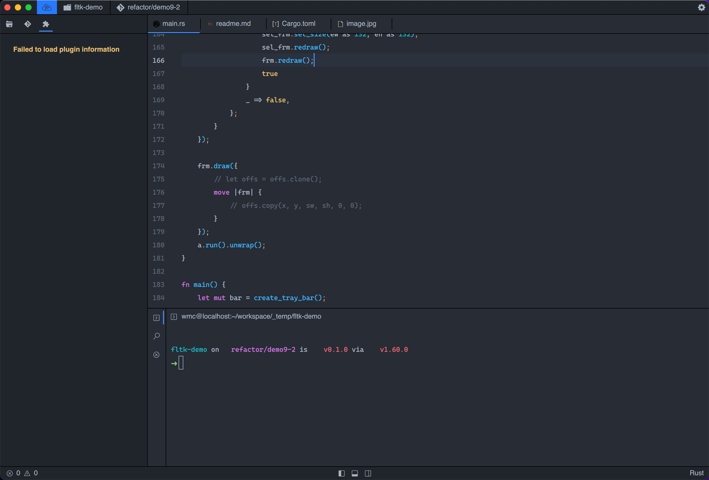

# Lapce

 

> Lapce 是用纯 Rust 编写的，用户界面是 Druid（也是用 Rust 编写）。它是用 Xi-Editor 的 Rope Science 设计的，使得计算速度快如闪电，并利用 OpenGL 进行渲染。关于 Lapce 功能的更多信息可以在主网站上找到，用户文档可以在 GitBook 上找到。
>
> 

一个有点像是 VSCode 的编辑器。

| 导航                                         | 徽章                                                                                                                                                                                         |
| :------------------------------------------- | :------------------------------------------------------------------------------------------------------------------------------------------------------------------------------------------- |
| [ 代码仓库 ](https://github.com/lapce/lapce) |   |
